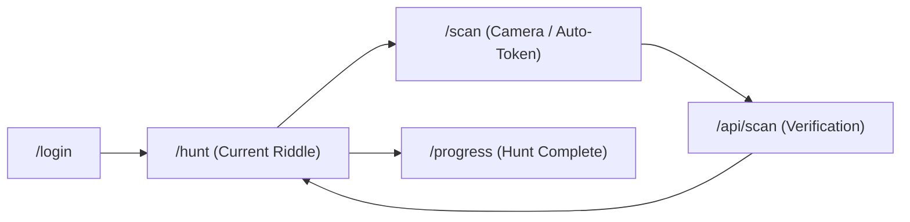

# HuntBase - Site Map & Route Reference

Comprehensive navigation and endpoint reference for HuntBase.

**Base URL:** `http://localhost:3000` (development) or production domain.

---

## 🎮 Participant Portal (Mobile-First Experience)

| Route | Page | Description | Access Control |
|---|---|---|---|
| `/` | Landing Page | Public platform landing page and club showcase | Public |
| `/login` | Team Login | Team credential authentication | Public |
| `/hunt` | Active Gameplay | Displays current riddle; consumes `/api/hunt/current-clue` | Team Session Required |
| `/scan` | QR Scanner | Camera-based scanner with native camera auto-redirect | Team Session Required |
| `/progress` | Progress & Results | Team score, completed checkpoints, and finish state | Team Session Required |

### Player Workflow

---

## 🛡️ Host & Club Administration Dashboard

| Route | Page | Description | Access Control |
|---|---|---|---|
| `/admin-login` | Host Login | Club organizer & Super Admin authentication | Public |
| `/admin` | Host Overview | Dashboard summary and active event quick-actions | Host Cookie Guard |
| `/admin/events` | Event Management | Create, schedule, activate, and finish hunt events | Host Cookie Guard |
| `/admin/clues` | Clue Management | Riddles, hint delays, secret answers & locations | Host Cookie Guard |
| `/admin/teams` | Team Management | Bulk team credential generator, rosters, score overrides | Host Cookie Guard |
| `/admin/qr-codes` | QR Generation | Clue QR codes, decoy fake codes, and bulk ZIP export | Host Cookie Guard |
| `/admin/theme` | Theme Customizer | Dynamic club styling, presets, color tokens, and asset uploads | Host Cookie Guard |
| `/admin/monitor` | Live Monitor | Real-time WebSocket board: live rankings, scans, decoy traps | Host Cookie Guard |

---

## 🔌 API Endpoints Reference

### Participant & Game Engine Endpoints
- `POST /api/auth/login`: Team credential validation & token issuance.
- `GET /api/hunt/current-clue`: Secure endpoint delivering active riddle (admin notes & coordinates stripped).
- `POST /api/scan`: Checkpoint token verification, anti-cheat validation, order progression, and scoring.
- `GET /api/teams/[id]`: Fresh team stats and step synchronization.
- `POST /api/hints/view`: Logs hint penalty and reveals hint text.

### Administrative & Management Endpoints
- `POST /api/auth/admin-login`: Host authentication and HttpOnly session cookie issuance.
- `POST /api/admin/upload-asset`: Multipart upload for club logos and banners to Supabase Storage.
- `GET / POST /api/admin/events`: Event creation and lifecycle control.
- `POST /api/admin/events/start-hunt`: Triggers round-robin clue distribution and starts countdown.
- `POST /api/admin/events/stop-hunt`: Terminates event timer and locks participant progress.
- `GET / POST /api/admin/clues`: Clue repository management.
- `GET / POST /api/admin/teams/generate`: Bulk algorithmic team account generation.
- `GET / POST /api/admin/qr/generate`: Server-side PNG/SVG QR generation and ZIP packaging.

---

## 🔒 Security & Middleware Matrix

All `/admin/*`, `/super-admin/*`, and `/api/admin/*` endpoints are protected by `src/middleware.ts` verifying the encrypted `huntbase_session` cookie before rendering or executing requests.

---

*GitHub Community GITAM - HuntBase Platform*
